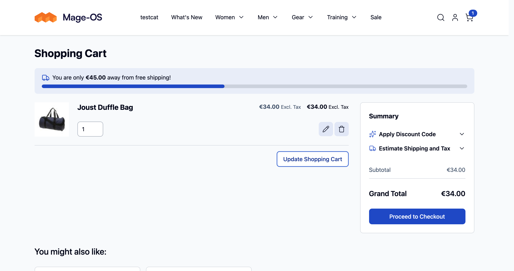
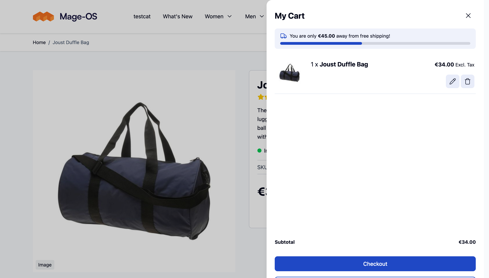
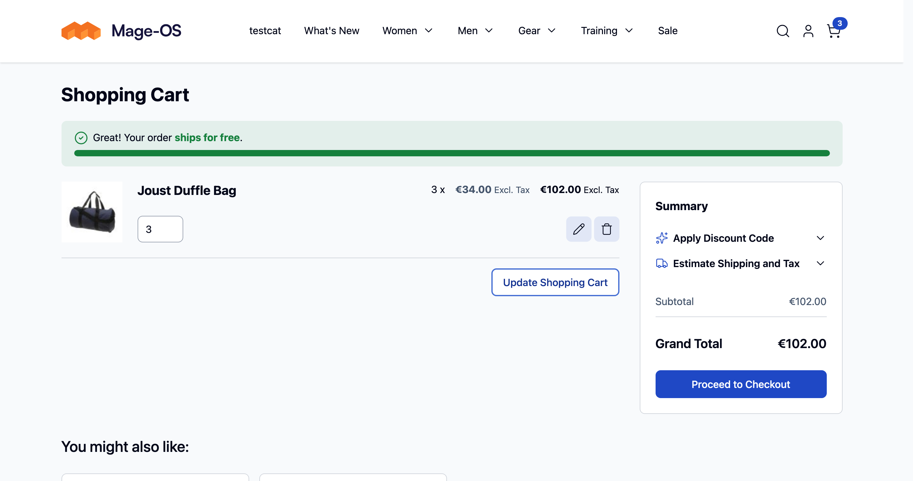
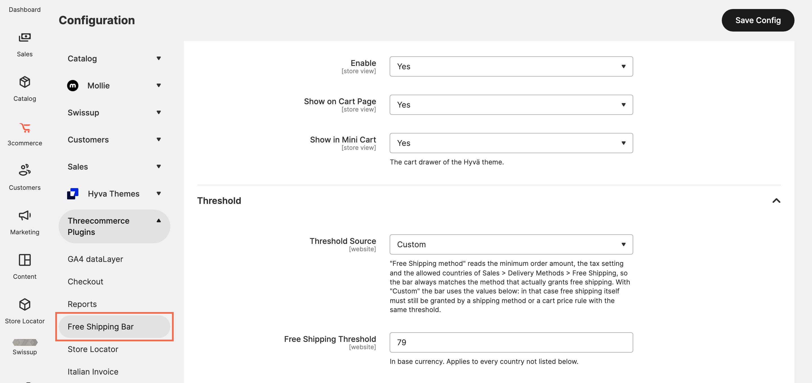

# Threecommerce Free Shipping Bar: free shipping progress bar for Magento 2 / Mage-OS

A **progress bar towards free shipping** for Magento 2 and Mage-OS: it shows how much is left, updates with the cart and confirms when the threshold is reached. Works with **Hyvä**, **Luma-based themes** and **Breeze**.



**Compatibility:** Magento Open Source / Adobe Commerce 2.4.4 – 2.4.9 · Mage-OS 1.x / 3.x · PHP 8.1 – 8.4 · Themes: Luma, Hyvä, Breeze
**License:** commercial · **Current version:** see [Releases](../../releases)

## Features

- **Cart page**: full-width bar above items and summary, rendered server side on every theme and refreshed on every cart update (quantity, remove, coupon).
- **Mini cart**: reads a `tc_free_shipping` key added to the `cart` customer section, so it works with full page cache and updates live when a product is added, changed or removed.
- **Amount** = discounted subtotal of the shipping address (tax included or excluded): the same formula Magento uses for the Free Shipping method, so coupons and cart price rules are included and shipping costs are not.
- **Threshold**: a custom amount with **per-country overrides** (empty amount = no bar for that country), or read from the Magento *Free Shipping* method (minimum amount, tax, specific countries) so the bar always matches it.
- Optional: a cart price rule that grants free shipping marks the goal as reached.
- **Messages** per store view with the `{remaining}` and `{threshold}` placeholders and limited HTML; English and Italian texts included.
- **Colors** from the admin or with the `--tc-fsb-color` and `--tc-fsb-reached` CSS variables; plain CSS, no extra libraries.
- Hyvä (Alpine), Luma and Breeze (Knockout) supported with no Hyvä dependency required.







## Requirements

- Magento Open Source / Adobe Commerce 2.4.4+ or Mage-OS
- PHP 8.1 – 8.4
- Package: `threecommerce/m2-base` (installed automatically by Composer)

## Installation

The package is distributed through our Composer repository at `repo.threecommerce.it`. Request the credentials from the [product page](https://www.threecommerce.it/barra-spedizione-gratuita-magento-2?utm_source=github&utm_medium=readme&utm_campaign=magento2-free-shipping-bar), then:

```bash
composer config repositories.threecommerce composer https://repo.threecommerce.it
composer require threecommerce/m2-free-shipping-bar
bin/magento module:enable Threecommerce_FreeShippingBar
bin/magento setup:upgrade
bin/magento cache:flush
```

## Configuration

Admin → **Stores → Configuration → Threecommerce Plugins → Free Shipping Bar**: enable, show in mini cart, threshold source (custom or Free Shipping method), default threshold and per-country overrides, tax basis, messages per store view and colors. The module only displays the progress: free shipping must be granted by a shipping method or cart price rule with the same threshold.

## Documentation and support

- Product page: [threecommerce.it/barra-spedizione-gratuita-magento-2](https://www.threecommerce.it/barra-spedizione-gratuita-magento-2?utm_source=github&utm_medium=readme&utm_campaign=magento2-free-shipping-bar)
- [Changelog](CHANGELOG.md) (in Italian)
- Support and custom development: [threecommerce.it/contatti](https://www.threecommerce.it/contatti?utm_source=github&utm_medium=readme&utm_campaign=magento2-free-shipping-bar)

---

*This repository is the public showcase of the module. The source code is kept in a private repository.*
